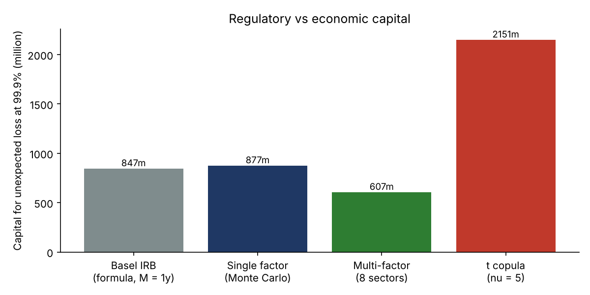
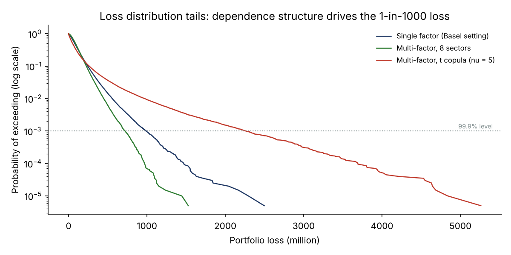
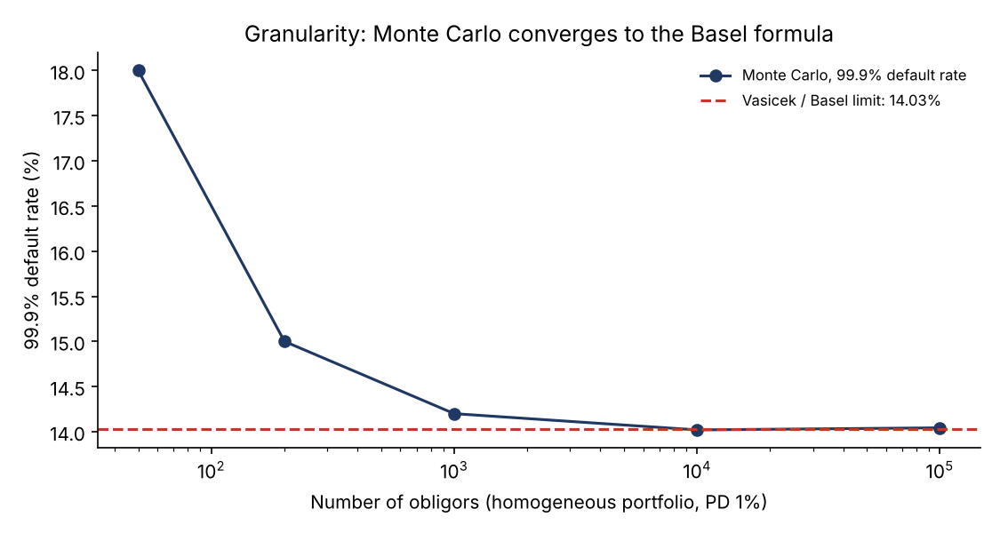
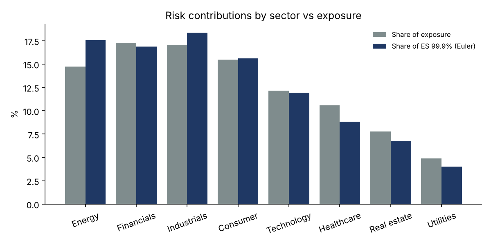

# Credit Portfolio Risk Engine: Basel IRB vs Monte Carlo Economic Capital

A from-scratch Python engine for the credit risk of a corporate loan book, built the way a bank's credit portfolio management or risk team would approach it:

1. **Basel IRB capital** for corporate exposures: asset correlation, maturity adjustment, capital K and risk-weighted assets.
2. **Monte Carlo economic capital** with a multi-factor model: a single-factor (Basel) setting, 8 correlated sectors, and a Student-t copula for joint extreme defaults.
3. **Risk measures**: expected loss, VaR and Expected Shortfall at 99.9%.
4. **Capital allocation**: Euler contributions to Expected Shortfall by sector, rating and obligor.
5. **Stress tests**: probabilities of default doubled and tripled.

The loan book is an illustrative portfolio of 2,000 corporate obligors (EUR 19.4bn of exposure) with a rating mix typical of a corporate and investment bank, 8 sectors and concentrated exposures. The theory is validated exactly, against a published IRB example and against the Vasicek limit.

## Key results

| Model | Expected loss | VaR 99.9% | ES 99.9% | Capital (VaR - EL) | vs Basel IRB |
|---|---|---|---|---|---|
| Basel IRB formula (M = 1 year) | 112.6m | n/a | n/a | 846.7m | 1.00x |
| Monte Carlo, single factor (Basel setting) | 112.5m | 989.2m | 1,199.9m | 876.6m | 1.04x |
| Monte Carlo, 8 sectors | 112.5m | 719.7m | 838.4m | 607.2m | 0.72x |
| Monte Carlo, 8 sectors, t copula (nu = 5) | 112.4m | 2,263.1m | 2,892.7m | 2,150.6m | 2.54x |



**What the table says:**

- **Name concentration adds capital.** In the Basel setting, the Monte Carlo capital is 4% above the formula. The formula assumes an infinitely granular portfolio, whereas this book behaves like only 592 equal exposures (inverse Herfindahl index): large single names add idiosyncratic risk that the formula ignores.
- **Sector diversification removes capital.** With 8 partly correlated sectors, capital falls by 28%. The Basel formula assumes a single systematic factor, so it gives no diversification benefit; that is a deliberate regulatory simplification.
- **The dependence model dominates everything.** With the same probabilities of default and the same correlations, a t copula multiplies capital by 2.5. Its common shock makes defaults cluster in bad years (tail dependence), which a Gaussian copula cannot produce. This is the kind of model risk often cited in the 2008 crisis, when Gaussian copula models understated joint defaults.



## Validation

| Check | Result |
|---|---|
| IRB formula vs published worked example (PD 1.5%, LGD 40%, M 3 years) | R 0.1767 vs 0.1768, K 7.97% vs 7.98% (example rounds its intermediate steps) |
| Convergence to the Vasicek limit (homogeneous portfolio, PD 1%) | gap +28% with 50 names, +1.2% with 1,000, -0.05% with 10,000 |
| Equal-exposure book, single factor: Monte Carlo capital / IRB | 0.98, 95% confidence interval 0.94 - 1.02 |
| Expected loss: analytic vs Monte Carlo | 112.63m vs 112.48m (0.75 standard errors) |
| Euler contributions: sum by sector and by obligor vs total ES | 838.4m = 838.4m = 838.4m |



**A finding from the validation work.** The first comparison used Basel's default effective maturity of 2.5 years, and the Monte Carlo capital came out 23% below the formula even for an equal-exposure book, where the two should agree. The cause is that the maturity adjustment MA(M) = (1 + (M - 2.5)b) / (1 - 1.5b) equals 1 at **one year**, not at 2.5 years. At 2.5 years it adds about 27% (1,078.6m instead of 846.7m) for downgrade risk over the life of the loan, which a one-year default model does not capture. Compared like for like at one year, the formula and the simulation agree within Monte Carlo noise.

## Where the risk sits: Euler allocation of Expected Shortfall

| Rating | Share of exposure | Share of ES 99.9% |
|---|---|---|
| AAA - A | 30.8% | 7.8% |
| BBB | 34.7% | 21.7% |
| BB | 20.5% | 28.6% |
| B | 11.3% | 27.8% |
| CCC | 2.7% | 14.0% |



- **Sub-investment grade drives the risk.** BB to CCC names hold 34.5% of exposure but 70% of tail risk.
- **Single names matter.** The largest contributor is one CCC energy obligor with EUR 110m of exposure, which alone accounts for 3.5% of ES.
- **Sectors differ.** Energy contributes more to ES than to exposure, because of its rating mix.

Euler contributions are the expected loss of each obligor in the tail scenarios, E[L_i | L >= VaR], and they add up exactly to ES. This is the basis for risk-adjusted pricing and limit setting.

## Stress tests (8-sector model)

| Scenario | Expected loss | VaR 99.9% | ES 99.9% | Capital (VaR - EL) | IRB capital (M = 1 year) |
|---|---|---|---|---|---|
| Base | 112.5m | 712.8m | 846.6m | 600.3m | 846.7m |
| PDs x 2 (downturn) | 225.3m | 1,124.2m | 1,293.4m | 898.9m (+50%) | 1,153.4m (+36%) |
| PDs x 3 (severe) | 338.0m | 1,461.7m | 1,644.5m | 1,123.8m (+87%) | 1,351.5m (+60%) |

Stress runs use 100,000 scenarios (200,000 in the main comparison), so the base VaR differs slightly from the key-results table (712.8m vs 719.7m).

Compared like for like (capital excluding expected loss), doubling the probabilities of default raises the Monte Carlo capital by 50% but IRB capital by only 36%. The IRB correlation falls as PD rises, which damps the formula's sensitivity in a downturn.

## Method notes

- **Asset returns:** Y_i = sqrt(R_i) S_s + sqrt(1 - R_i) e_i, with sector factor S_s = sqrt(w) Z_global + sqrt(1 - w) Z_s and w = 0.6. R_i is the IRB correlation, so each obligor carries exactly the systematic risk assumed by Basel. With w = 1 the model reduces to the single-factor Basel setting.
- **Defaults** are simulated conditionally on the factors (200,000 scenarios): given the factors, defaults are independent with probability N((G(PD_i) - sqrt(R_i) S) / sqrt(1 - R_i)).
- **t copula:** asset returns are divided by sqrt(W / nu), with W a chi-squared variable common to all obligors.
- **Vasicek limit:** homogeneous portfolios are simulated exactly with the conditional binomial distribution, with 2 million scenarios per portfolio size.
- **Exposures and LGD:** lognormal exposures (concentrated book) and an LGD of 45%. The master scale runs from 0.03% (AAA) to 15% (CCC).

## Repository structure

```
├── run_study.py        # validation, capital comparison, allocation, stress tests, charts
├── src/
│   ├── irb.py          # Basel IRB formula and the Vasicek distribution
│   └── simulation.py   # portfolio, multi-factor Gaussian and t copula Monte Carlo
└── results/
    ├── figures/
    ├── tables/         # capital, validation, contributions, stress tests, portfolio
    └── run_log.txt
```

## How to run

```bash
pip install -r requirements.txt
python run_study.py
```

The full run takes about four minutes.

## Limitations and next steps

- **Stochastic LGD** correlated with defaults (downturn LGD).
- **Migration risk:** a CreditMetrics-style mark-to-market model, to capture what the maturity adjustment approximates.
- **Calibration on real data:** sector correlations from equity returns, and asset correlation from historical default rates by maximum likelihood on the Vasicek distribution.
- **Analytic granularity adjustment** (Gordy & Lütkebohmert) to compare with the simulated name-concentration effect, and importance sampling to sharpen the 99.9% estimates.

## References

- Basel Committee on Banking Supervision (2005). *An Explanatory Note on the Basel II IRB Risk Weight Functions*.
- Vasicek, O. (2002). The distribution of loan portfolio value. *Risk*.
- Gordy, M. (2003). A risk-factor model foundation for ratings-based bank capital rules. *Journal of Financial Intermediation*.
- Tasche, D. (2008). Capital allocation to business units and sub-portfolios: the Euler principle.

---

**Author:** Yassine El Bakali, MSc in Actuarial Science (ULB) · yelbakali@yahoo.be
